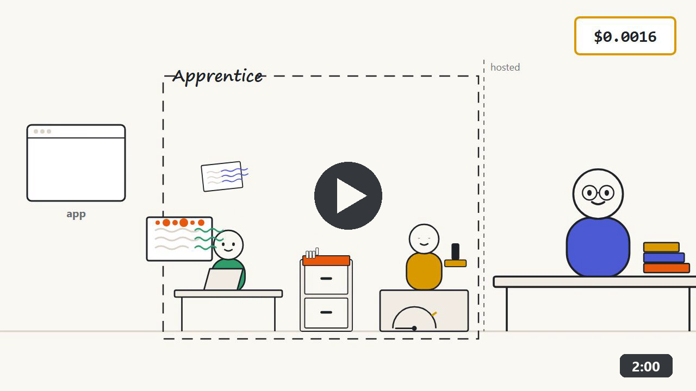
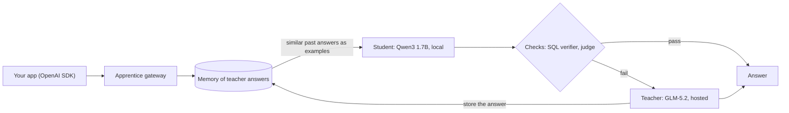

# Apprentice

**A small open model that learns from a large open model, so each request costs less over time.**

[](LICENSE)
[](https://www.python.org/downloads/)
[](https://colab.research.google.com/github/Ayush-e4/apprentice/blob/main/notebooks/train_sql_judge.ipynb)

Apprentice is an OpenAI-compatible gateway. You point your app at it instead of a model provider, and it decides, request by request, whether a small local model can answer or a large hosted one has to.

## Watch the 2-minute explainer

[](docs/video/apprentice-explainer.mp4)

Click the image to play. It covers how a request moves through the student, judge, teacher and memory, and the measured results below. Narrated with [Kokoro](https://github.com/thewh1teagle/kokoro-onnx) (open-weight TTS) and animated with Remotion and GSAP.

## The problem

Most apps send every request to a frontier model and pay frontier prices for it, even when the request is one they have answered a hundred times before. Small open-weight models are cheap enough to run on a laptop, but on their own they get too many answers wrong to be trusted. Apprentice puts the small model first, checks its work, and calls the large model only when the check fails.

## How it works



- **Student first.** Every request goes to a small open-weight model (Qwen3 1.7B) running locally through [Ollama](https://ollama.com). It costs nothing per token.
- **Teacher as backup.** A large open-weight model (GLM-5.2, MIT) behind Command Code's OpenAI-compatible Provider API answers the requests the student fails.
- **Checks decide when to escalate.** A verifier rejects answers that are clearly broken (for SQL: the query errors or returns no rows). An optional judge rejects answers that run but are wrong.
- **Memory makes the student better.** Teacher answers are stored. For each new request, the most similar past answers are inserted into the student's prompt as few-shot examples.
- **The student's share grows over time.** As memory fills up, more requests pass the checks on the first try, so fewer reach the teacher and cost and latency fall.
- **Everything is logged.** Each request is stored in SQLite with who answered, why, cost and latency, and shown on a live dashboard.

## Results

Text-to-SQL benchmark, 80 held-out questions. Student: Qwen3 1.7B on a laptop GTX 1650. Teacher: GLM-5.2. Memory search used `nomic-embed-text` embeddings via Ollama. Memory was filled during a warm-up over the 185 training questions; test questions are never written to memory.

| Phase | Run | Accuracy | Handled by student | Cost | Median latency |
|---|---|---|---|---|---|
| Before | Student only | 25% | 100% | $0.0000 | 2.3 s |
| Before | Teacher only | 100% | 0% | $0.1261 | 5.3 s |
| Before | Cascade | 55% | 70% | $0.0451 | 2.5 s |
| Warm-up | Cascade, 185 questions | 78% | 97% | $0.0110 | 1.5 s |
| After | Student + memory | 84% | 100% | $0.0000 | 2.9 s |
| After | Cascade + memory | 84% | 100% | $0.0000 | 2.9 s |
| **With the trained judge** | | | | | |
| Warm-up | Cascade + judge, 185 questions | 97% | 85% | $0.0414 | 2.4 s |
| After | Student + memory | **96%** | 100% | **$0.0000** | 3.4 s |
| After | Cascade + memory + judge | **97.5%** | 86% | $0.0165 | 3.1 s |

Without a judge, six remembered teacher answers take the student from 25% to 84% on unseen questions at zero teacher cost. The SQL check alone only escalates queries that fail, so most wrong-but-runnable answers were never sent to the teacher, and memory stayed at 6 entries. With the trained judge, those answers are escalated, the teacher's corrections are remembered (27 entries), and the student alone reaches **96%**. The cascade with the judge reaches **97.5% at 13% of the teacher-only cost**, with 86% of questions answered locally.

Read this with its limits in mind: test questions come from the same 16 templates as the training questions, the database is synthetic, each row is a single run, and the "with judge" runs started from an empty memory after the runs above. Details and how to reproduce: [docs/benchmark.md](docs/benchmark.md).

One setting mattered a lot: turning off Qwen3's hidden reasoning (`reasoning_effort: "none"`, since Ollama ignores `/no_think`) cut the student from about 800 to about 80 output tokens and from 12.5 s to 1.4 s per answer.

## Quick start

You need Python 3.11+, [Ollama](https://ollama.com), and an API key for the teacher endpoint.

```bash
git clone https://github.com/Ayush-e4/apprentice.git
cd apprentice
python -m venv .venv
source .venv/bin/activate          # Windows: .venv\Scripts\activate
pip install -r requirements.txt
ollama pull qwen3:1.7b
cp .env.example .env               # Windows: copy .env.example .env
```

Open `.env` and set `TEACHER_API_KEY`. The benchmark above used `TEACHER_MODEL=zai-org/GLM-5.2` (the default in `.env.example`); set `TEACHER_PRICE_IN` and `TEACHER_PRICE_OUT` (USD per 1M tokens) from your provider's pricing page if you want cost numbers. Every setting is explained in [docs/configuration.md](docs/configuration.md).

Start the gateway:

```bash
uvicorn apprentice.gateway:app --port 8000
```

The gateway serves APIs only. The UI is the web app in [`web/`](web/README.md) (Next.js): `cd web`, `npm install`, `npm run build`, `npm start -- -p 3100`, then open <http://localhost:3100>. It has an overview, Kirana Copilot, the QuickBite support demo, and a dashboard with requests, the share handled by the student, cost, latency, memory size, health and benchmark runs. Old gateway page URLs (`/`, `/shop`, `/support`) redirect there; set `WEB_URL` if it runs elsewhere.

On Windows, `powershell -ExecutionPolicy Bypass -File scripts\demo.ps1` starts both gateways and the web app, then prints a health check of every dependency.

Send a request with any OpenAI client (`pip install openai`):

```python
from openai import OpenAI

client = OpenAI(base_url="http://localhost:8000/v1", api_key="unused")
reply = client.chat.completions.create(
    model="apprentice",
    messages=[{"role": "user", "content": "Explain a SQL LEFT JOIN in one sentence."}],
    extra_body={"apprentice": {"mode": "cascade"}},
)
print(reply.choices[0].message.content)
print(reply.model_extra["apprentice"])  # served_by, escalated, reason, cost_usd, latency_ms, ...
```

Or with `curl` (macOS/Linux shell):

```bash
curl http://localhost:8000/v1/chat/completions -H "Content-Type: application/json" \
  -d '{"model": "apprentice", "messages": [{"role": "user", "content": "Hello"}], "apprentice": {"mode": "student"}}'
```

Run the benchmark (with the gateway running, in a second terminal):

```bash
python -m bench.run_eval all       # before -> warm-up (fills memory) -> after
python -m bench.run_eval all --limit 5   # a quick smoke test on 5 questions per split
```

Results appear on the dashboard as each run finishes.

For a customer-support demo, where repeated questions move from the teacher to the student, open <http://localhost:3100/support>; see [docs/support-demo.md](docs/support-demo.md). In our run with real models, 18 of 30 simulated customers (60%) were answered locally, for $0.025 in total.

### Web app

The web app proxies `/gw/*` to `APPRENTICE_URL` (default `http://localhost:8000`) and `/support-gw/*` to `SUPPORT_URL` (default `http://localhost:8001`, the support demo's own gateway and memory). See [web/README.md](web/README.md).

## Per-request options

Put options in an `apprentice` object in the request body, or send them as `X-Apprentice-<Option>` headers (for example `X-Apprentice-Mode: student`).

| Option | Values | Default | What it does |
|---|---|---|---|
| `mode` | `cascade`, `student`, `teacher` | `cascade` | `cascade` tries the student and escalates when a check fails. `student` and `teacher` call one model only. |
| `memory` | `true`, `false` | `true` | Add similar remembered teacher answers to the student's prompt as examples. |
| `learn` | `true`, `false` | `true` | Store teacher answers in memory. With a verifier, only answers that pass it are stored. |
| `verifier` | `sql` | none | The student's SQL must run against the shop database and return rows, otherwise the request escalates. |
| `judge` | `decision`, `llm` | none | A second check on answers that passed the verifier. Low scores escalate. See [Judges](#judges). |
| `tag` | any string | none | Label stored with the trace (the benchmark uses it to name runs). |
| `scope` | any string | hash of the system messages | Memory scope. Remembered answers are only reused for requests in the same scope, so apps with different system prompts never see each other's memory. Give two apps the same `scope` to share memory on purpose. |

In `cascade` mode **without** a verifier, the student answers only when memory holds a similar teacher answer (similarity at least `MEMORY_MIN_SIM`); otherwise the teacher answers. If a judge is unreachable or not configured, the student's answer is let through and the trace's `reason` says so.

Every response is a standard chat completion plus an `apprentice` field: `served_by`, `escalated`, `reason`, `cost_usd`, `latency_ms`, `memory_hits`, `top_sim`, `check_score` and `trace_id`. Streaming is not supported yet.

## Judges

The SQL verifier only catches queries that fail or return nothing. A query that runs and returns the wrong number passes it. A judge looks at the question, the query and the first rows it returns, and scores whether the query actually answers the question.

- **`judge=decision`**: any server that speaks the `/v1/systemone` decision protocol, such as [Von](https://github.com/wfzyx/von) or [Kev](https://github.com/jaredpalmer/kev). It returns the probability that the answer is correct; scores below `JUDGE_THRESHOLD` (default 0.8) escalate.
- **`judge=llm`**: any OpenAI-compatible chat model answers `yes` or `no` to the same question. By default it uses the teacher's endpoint.

Off-the-shelf decision models could not judge our SQL: Von scored correct and wrong queries almost the same (0.745 vs 0.734 on average), and the released Kev-0.8B scored 45.7% on our 610 held-out judge examples, below the 58.7% you would get by always answering "wrong". GLM-5.2 as a yes/no judge caught 30 of 30 wrong queries but accepted only 11 of 30 correct ones, at about 10.6 s per check, so it is a backup rather than the default.

So we fine-tune Kev-0.8B on labelled examples generated from our own benchmark. You can run the same training on a free Colab T4 GPU:

[](https://colab.research.google.com/github/Ayush-e4/apprentice/blob/main/notebooks/train_sql_judge.ipynb)

**Fine-tuned judge results.** On the 610 held-out judge examples, accuracy went from 45.7% (released Kev-0.8B) to **99.3%**, with expected calibration error 0.004. On the 30 correct-vs-wrong pairs that Von and the LLM judge failed, it accepted 30 of 30 correct queries and caught 29 of 30 wrong ones, at about 0.4 s per check. These held-out examples share the training templates, so this shows the judge learned this benchmark, not arbitrary SQL. Full numbers: [docs/judges.md](docs/judges.md#fine-tuned-judge-results).

How the training data is built, how to serve a judge, and all judge settings: [docs/judges.md](docs/judges.md).

## Use it from Claude Code or Cursor (MCP)

Apprentice is also an MCP server, so Claude Code, Cursor, Claude Desktop or any MCP client can ask it questions as a tool (`ask`, `ask_shop_sql`, `stats`, `recent_requests`, `benchmark_results`). It talks to a running gateway, so start one first (Quick start above).

No clone is needed for the MCP side. With [uv](https://docs.astral.sh/uv/), add this to your client's MCP config (for Claude Code, a `.mcp.json` in your project; a copy is in [`.mcp.json.example`](.mcp.json.example)):

```json
{
  "mcpServers": {
    "apprentice": {
      "command": "uvx",
      "args": ["--from", "git+https://github.com/Ayush-e4/apprentice", "apprentice-mcp"],
      "env": { "APPRENTICE_URL": "http://localhost:8000" }
    }
  }
}
```

Or install the command once with `pip install "git+https://github.com/Ayush-e4/apprentice"` and use `"command": "apprentice-mcp"`. For Claude Code from the command line: `claude mcp add apprentice -e APPRENTICE_URL=http://localhost:8000 -- uvx --from git+https://github.com/Ayush-e4/apprentice apprentice-mcp`. Then ask, for example, *"Use apprentice to find which store had the most orders in March 2026."* Tools, Cursor and Claude Desktop setup, and troubleshooting: [docs/mcp.md](docs/mcp.md).

## Models and licenses

| Role | Model | License | Where it runs |
|---|---|---|---|
| Student | [Qwen3](https://ollama.com/library/qwen3) 1.7B | Apache-2.0 | Locally, via Ollama |
| Teacher | GLM-5.2 | MIT | Command Code Provider API (OpenAI-compatible) |
| Decision judge (being fine-tuned) | [Kev-0.8B](https://github.com/jaredpalmer/kev), built on Qwen3.5-0.8B-Base (Apache-2.0) | Apache-2.0 | Locally or on Colab |
| Decision judge (default in `.env.example`) | [Von](https://github.com/wfzyx/von) | Apache-2.0 | Locally, on CPU |
| LLM judge (backup) | The teacher model by default | MIT | Same as the teacher |

Closed models are optional and are never the teacher. Because every role is just an endpoint, you can plug in a closed model where it helps, for example a hosted chat model such as GPT-6 Luna as the LLM judge, or TypeSafe's hosted Jev as a decision judge. Nothing in Apprentice requires one.

## Project layout

```
apprentice/
  gateway.py          FastAPI app: /v1/chat/completions, /v1/models, the web app's APIs
  engine.py           Routing between student and teacher, checks, learning
  providers.py        Calls to OpenAI-compatible chat and embedding endpoints, with fallback
  memory.py           Stores teacher answers; finds similar ones (embeddings or word overlap)
  verifiers.py        SQL verifier: extract the query, run it read-only, require rows
  judges.py           Decision-model judge over /v1/systemone
  llm_judge.py        Yes/no judge using any OpenAI-compatible chat model
  config.py           Settings loaded from .env
  db.py               SQLite storage for traces, memory and benchmark runs
  shop.py             Kirana Copilot API: question -> SQL -> answer table (read-only)
  support/            QuickBite support demo API
  health.py           /api/health: is every dependency reachable?
  mcp_server.py       MCP server (see docs/mcp.md)
  web.py              Redirects old page URLs to the web app
web/                  Next.js web app: overview, Kirana Copilot, QuickBite, dashboard
bench/
  shopdb.py           Builds the synthetic Mumbai grocery-chain database
  questions.py        16 question templates with gold SQL; the train/test split
  run_eval.py         Runs the benchmark phases through the gateway
  judge_data.py       Builds labelled examples for training a SQL judge
  unseen.py           Question types never seen in training (docs/generalization.md)
  adversarial.py      Hostile and nonsense inputs (docs/safety.md)
data/judge/           Judge training (1,401) and held-out (610) examples
notebooks/            Colab notebook that fine-tunes Kev-0.8B as a SQL judge
scripts/demo.ps1      Starts gateways and web app, prints a health check
docs/                 Benchmark, judges, generalization, safety, MCP and configuration details
.env.example          Every setting, with comments
```

## Contributing

Contributions are welcome, including small ones. Read [CONTRIBUTING.md](CONTRIBUTING.md) for how to set up the project, what we are looking for, and how to open a pull request. Good places to start: a new verifier in `apprentice/verifiers.py`, streaming support in `apprentice/gateway.py`, or a new set of question templates in `bench/questions.py`.

## License

MIT. See [LICENSE](LICENSE).

---

Built at Hacktoberfest 2026 Mumbai for the MLH **Best Open-Source AI Project** challenge.
